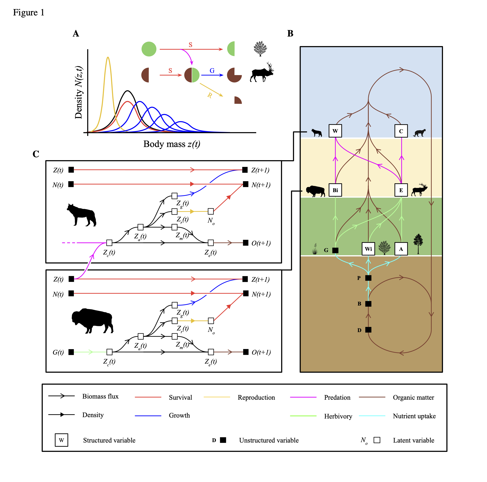

# Eco-IPM 

This repository contains the code necessary to build, simulate, and fit ecosystem integral projection models (Eco-IPMs).



---
## Get started

---
### Set up locally

First make sure that you have installed Python and Anaconda for managing virtual environments.

To install the environment required for running the model run the following commands:

The Conda environment specification is provided in `environment.yaml`.

```
conda env create --name mbipm --file=environment.yaml
conda activate mbipm
```

If this does not work you may have to create an empty environment and install packages manually:

```
conda create -n mbipm python=3.10 numpy matplotlib seaborn jupyter
conda activate mbipm
pip3 install torch torchvision
```
Now you can open jupyter lab by running in the terminal the following command:

```
jupyter lab
```

You are ready to explore the notebooks.

---
### Set up on Colab

1. Open [Google Colab](https://colab.research.google.com/).
2. Sign in to your Google account.
3. Select **File > Open notebook > GitHub** and enter the repository URL: <https://github.com/WillemBonnaffe/Eco-IPM>.
4. Open `E1-tutorial-V2.ipynb`.
5. To use GPU acceleration, select **Runtime > Change runtime type > T4 GPU**. You may need to click **Connect** in the top-right corner.
6. Follow the instructions in the notebook.

---
## Notebooks

The repository contains multiple notebooks that can be run sequentially.

`A1-format-time-series.r` is an R script that formats the full time series of animal counts in Yellowstone by reading the input data files located in the `data` folder.

`C1-setup-calibration.ipynb` is a jupyter notebook that prepares the Yellowstone ecosystem model (YEM) for fitting to the time series.  

`C2-calibrate-artificial-data.ipynb` fits the YEM to simulated time-series data and visualises the parameter optimisation chains.

`C3a-calibrate-cross-validation.ipynb` fits the YEM to the time series using cross-validation to assess out-of-sample predictions.

`C3b-check-cross-validation.ipynb` simulates the calibrated YEM and compares parameter estimates and model outputs from the cross-validation runs.

`C4a-calibrate-full.ipynb` fits the YEM to the full Yellowstone time series and visualises the parameter optimisation chains.

`C4b-check-calibrate-full.ipynb` simulates the fully calibrated YEM and analyses the fitted parameter values and resulting model outputs.

`C4c-check-calibrate-full-repeated-1.ipynb` checks consistency of predictions in a repeated calibration run. 

`D1-simulate.ipynb` takes the calibrated model and performs long term simulations.

`D2a-simulate-extirpation-short.ipynb` simulates short-term predator extirpation and reintroduction and estimates the time to perturbation and recovery equilibria.

`D2b-simulate-extirpation-short-adjoint-sensitivity.ipynb` simulates short-term predator extirpation and reintroduction and calculates adjoint sensitivities during the experiment.

`D2c-simulate-extirpation-short-adjoint-sensitivity-repeated-1.ipynb` check consistency of the short-term experiment with another model from a repeated calibration run.

`D2d-simulate-extirpation-short-adjoint-sensitivity-repeated-2.ipynb` check consistency of the short-term experiment with another model from a repeated calibration run.

`D2e-simulate-extirpation-long.ipynb` simulates long-term predator extirpation and reintroduction and estimates the time to perturbation and recovery equilibria.

`D4-simulate-sensitivity-V1-14-25-10-10.ipynb` tests how changing model parameters affects simulated ecosystem dynamics.

`E1-tutorial-V2.ipynb` introduces how to load and simulate the Eco-IPM, change its parameters, and run a sensitivity analysis.

---
## Supporting files

The notebooks call various files which are detailed below.

`À1-outputs/A1-tab-all-time-series.csv` is the formatted time series that can be used to calibrate the model.

`f_YEM_<model-version-name>.py` defines all functions necessary to initiate and simulate the YEM.

`f_YEM_<model-version-name>_elasticity.py` defines functions to calculate the elasticity of the model dynamics.

`f_YEM_wrapper_<model-version-name>.py` defines a wrapper to optimise the paramters of the YEM following DE optimisation. 

`f_demc_sparse_noise.py` contains functions that are necessary to perform DE optimisation.

`ìnitial-conditions-<model-version-name>.yaml` contains the initial state of the variables in the YEM before calibration.

`ìnitial-conditions-apriori-<model-version-name>.yaml` contains the initial state of the variables in the YEM after calibration.

`parameters-aposteriori-<model-version-name>.yaml` contains the values of all parameters in the YEM after calibration.

`parameters-apriori-<model-version-name>.yaml` contains the values of all parameters in the YEM before calibration.

`settings-apriori-<model-version-name>.yaml` contains the settings (e.g. number of bins) of the YEM both for usable before and after calibration.

---
## Outputs

`A1-outputs/` contains the formatted time-series CSV and PNG figures produced while formatting the source time series.

`C2-outputs/`, `C3-outputs/`, and `C4-outputs/` contain saved calibration chains and associated likelihood results for the artificial-data, cross-validation, and full-data calibration workflows, respectively.

`figures/` contains PDF figures produced by the simulation, extirpation, sensitivity, and calibration-check notebooks.

---
## Data

All data necessary to parameterise and calibrate the model are located in the folder `data`.

`data/master-v2025-05-15-17-06.xlsx` contains all raw time series of elk, bison, cougar, and wolves.

`data/atchley-1989-table-8.csv` contains plant measurements grouped by soil type. `Soil` names the soil category; `Shoot wt. (g)` and `Root wt. (g)` give shoot and root weights (g); `Height (cm)` gives plant height (cm); `Shoot/root` is the shoot-to-root weight ratio; and `% Emerg.` gives the percentage emergence.

`data/bella-1980-table-1.csv` reports tree and plant biomass by stand age and density. `Age (years)` gives stand age; `Dominant height (m)` gives dominant tree height; `Number of trees (ha^-1)` gives tree density (ha^-1); `Woody material (kg·ha^-1)` and `Leaves (kg·ha^-1)` give woody and leaf biomass (kg·ha^-1); `Total (kg·ha^-1)` gives their total biomass (kg·ha^-1).

`data/brice-2024-fig-7.csv` contains browse probability by plant height. `height` identifies the height measure (cm); `browse.probability` gives the corresponding probability. Data rows include an initial row identifier before these two values.

`data/cole-2021-fig-6.csv` contains reproduction values by age. `age` identifies the age measure (years); `reproduction` gives the corresponding reproduction value. Data rows include an initial row identifier before these two values.

`data/master-v2025-05-15-17-06.xlsx` contains the following sheets:

- `sources`: `sheet` identifies the workbook sheet; `original_file_name` gives its source filename; `source` gives the source URL; `reference` gives the cited publication; `date_created` records when the source entry was added.
- `versions`: `version` names a workbook version; `origin` names the workbook it derives from; `date` gives the version date; `comment` describes the change.
- `grass-biomass`: `cell` identifies the sampling cell; `year` and `calendar_year` give the year; `period` gives the sampled period; `biomass` gives measured grass biomass (lb·acre^-1).
- `willow-heights`: `willid_full` is a combined willow identifier; `year`, `period`, and `calendar_year` give timing; `treat` is the treatment; `site_id`, `exp`, and `willid` identify site, experiment, and plant; `fall_height` is fall plant height (cm); `species_id` identifies species; `fence` and `dam` indicate fencing and dam status; `browse` records browsing; `n_plants` is the plant sample size; `n_years` is the number of observation years; `min_year` and `max_year` give the observation range; `site_full` is a combined site identifier. Full metadata can be found in data/supporting-time-series/willow.
- `aspen-heights`: `year`, `period`, and `calendar_year` give timing; `plot` and `tree` identify the sample; `new` indicates a newly recorded tree; `browse_winter` records winter browsing; `cag_cm` is change in annual growth (cm); `height_cm` is tree height (cm).
- `elk-counts-uncorrected`: `year`, `period`, and `calendar_year` give the count timing; `northern_YNP_count` is the uncorrected elk count for Yellowstone’s northern range.
- `elk-counts-corrected`: `year`, `period`, and `calendar_year` give the count timing; `northern_YNP_count` is the northern-range estimate; `northern_YNP_lwr_CL` and `northern_YNP_upr_CL` are its lower and upper confidence limits; `interior_YNP_mean`, `interior_YNP_lwr_CL`, and `interior_YNP_upr_CL` give the interior estimate and confidence limits; `exterior_YNP_mean`, `exterior_YNP_lwr_CL`, and `exterior_YNP_upr_CL` give the exterior estimate and confidence limits.
- `elk-culls`: `year`, `period`, and `calendar_year` give the cull timing; `northern_YNP_culls` is the number of northern-range elk culled.
- `bison-counts`: `year`, `period`, and `calendar_year` give the count timing; `northern_YNP_count`, `interior_YNP_count`, and `total_YNP_count` give bison counts for the northern range, interior, and park total; `comment` contains notes.
- `bison-culls`: `year`, `period`, `period_old`, and `calendar_year` give cull timing in current and original formats; `northern_YNP_culls`, `interior_YNP_culls`, and `total_YNP_culls` give culls for the northern range, interior, and total.
- `wolf-counts`: `year`, `period`, and `calendar_year` give the count timing; `northern_YNP_count`, `interior_YNP_count`, and `total_YNP_count` give wolf counts for the northern range, interior, and park total; `comment` contains notes.
- `wolf-culls`: `year`, `period`, and `calendar_year` give the cull timing; `total_YNP_culls` is the total number of wolves culled in Yellowstone; `comment` contains notes.
- `cougar-counts`: `year`, `period`, `period_old`, and `calendar_year` give count timing in current and original formats; `density_per_100km2` is cougar density (100 km²); `northern_YNP_count` is the northern-range count; `comment` contains notes.
- `notes`: the first column contains the note date and the second contains the associated note text.

---
## Supplementary data

These files are not necessary to run the pipeline but can be used to produce the initial input data files previously described.

`supporting-data-2025-04-14-aspen` contains the supplementary analysis of aspen data. The file `analysis-aspen.r` contains the script of the analysis. The figures were digitised by converting x and y locations in pixels to x- and y-axis units. The intermediate files containing the `x` and `y` coordinates in pixels of the observations are named `<author>-<year>-fig-pixel-values.csv`, while those containing the `value` of x- and y-axes ticks and corresponding `x` and `y` pixel coordinates are named `<author>-<year>-fig-<x/y>-axis-pixel-values.csv`. 

`supporting-data-2025-04-18-willow` contains the supplementary analysis of willow data. The file `analysis-aspen.r` contains the script of the analysis.

The raw files for each sheet are located in the `supporting-time-series` folder. 
